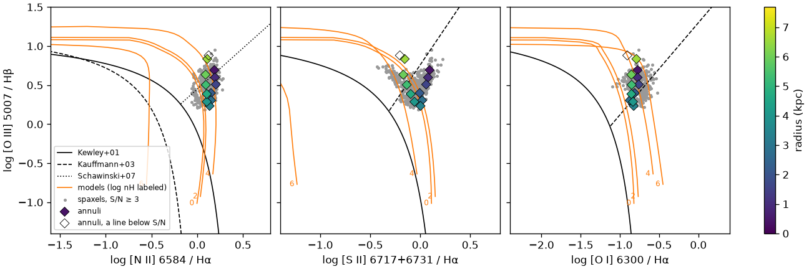
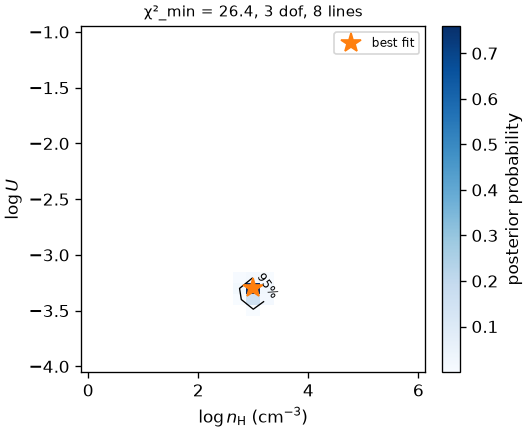
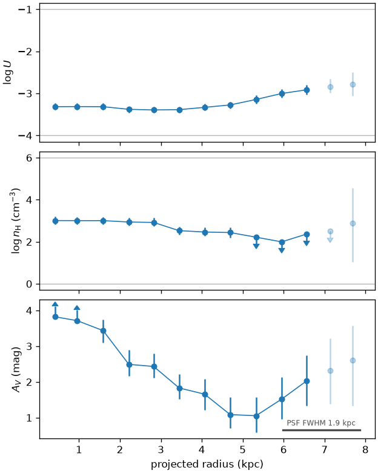
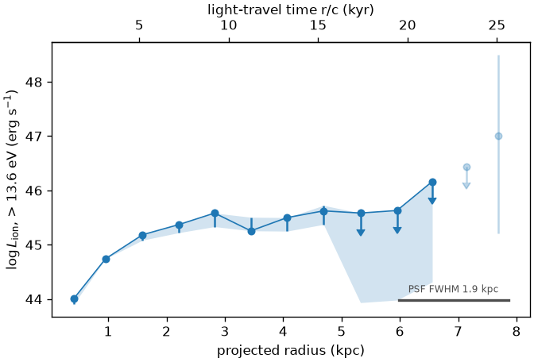
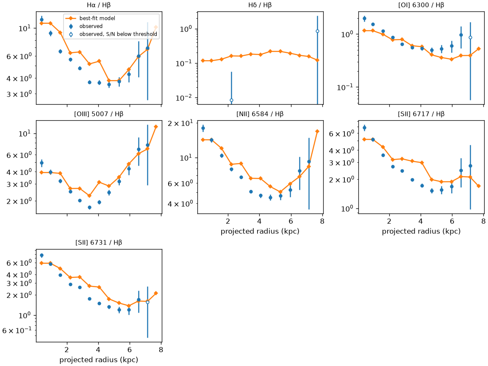
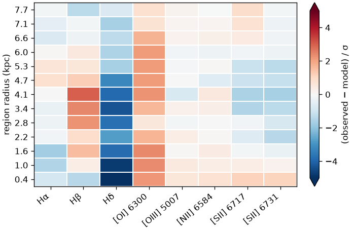

# Figures

The [`eelrfit.plotting`][eelrfit.plotting] module, which requires the `plot`
extra (`pip install 'eelrfit[plot]'`), draws the figures commonly used in
photoionization studies of EELRs directly from EELRFit's result objects. Each
function accepts an optional `ax` or `axes` argument and returns the axes it
drew on, so the figures can be combined and customized. The functions use
plain matplotlib and its default colors, so the usual tools, such as
`plt.style.use` or rcParams, change their appearance. The examples below show
MaNGA 11965-3703, fitted with the `starecheski_agn_free_no` grid.

```python
from eelrfit import plotting as P
from eelrfit.regions import annuli

result = analyze(maps, grid, sed=grid.sed())
```

## Line maps

```python
P.plot_line_map(maps, "OIII_5007", regions=annuli(maps))
```

![[O III] map with annuli](../images/line_map.png)

## BPT diagrams

The BPT diagrams show the spaxels and annuli against the standard demarcation
lines. The annuli are colored by radius, and open markers indicate that one of
the lines is below the S/N threshold. When a grid is given, the diagrams also
show its model tracks, one for each density, with $\log U$ increasing upward
along each track. Any other grid parameters are held at the values in
`grid_at`, or at solar values by default.

```python
P.plot_bpt(maps, regions_table=result.regions, grid=grid, grid_at={"log_N_scale": 0.2})
```



## Posteriors

```python
P.plot_posterior(result.fits[2])                          # one annulus
P.plot_posterior_panels(result.results, result.fits)      # several annuli, spread over radius
```



In the panels, dotted lines mark constant $n_\mathrm{H} U$, which corresponds
to constant luminosity at the radius of the annulus (see
[limits](fitting.md#limits)).

## Radial profiles and the luminosity history

```python
P.plot_parameter_profiles(result.results)
P.plot_luminosity_history(result.results, current={"IR": 44.0})
```

Limits are drawn as arrows at their quoted values, and unconstrained annuli
are faded. A bar along the bottom shows the PSF FWHM, since annuli closer
together than that are not independent. The top axis of the luminosity
history gives the light-travel time $r/c$. Because the radii are projected,
this is a lower limit on the look-back time. To compare several models, pass a
mapping from labels to results tables.





## Fit quality

```python
P.plot_line_ratios(result.regions, result.fits)                 # observed and best-fit ratios to H-beta
P.plot_residuals(result.results, result.fits, result.regions)   # (observed − model)/σ for each annulus and line
```




