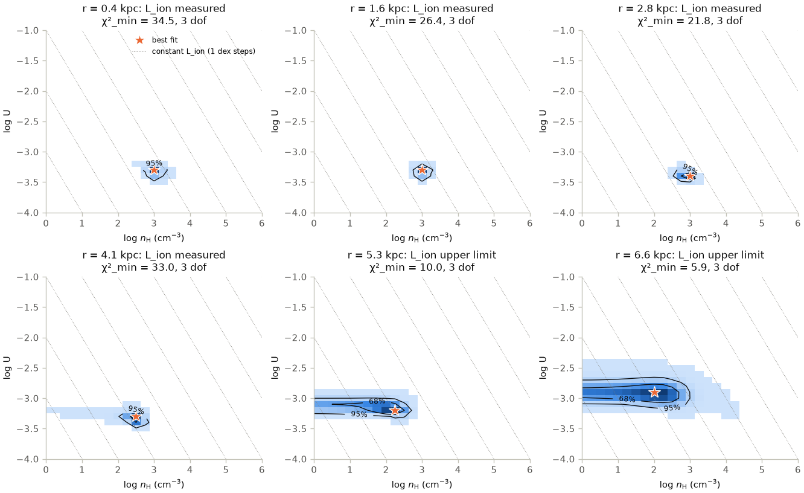

# Fitting and results

[`analyze`][eelrfit.pipeline.analyze] runs the complete analysis on one set of
maps.

```python
from eelrfit.fit import FitConfig
from eelrfit.pipeline import analyze

result = analyze(maps, grid, sed=grid.sed())
result.regions    # measured line fluxes in each annulus
result.results    # fitted parameters and luminosities in each annulus
result.fits       # full posteriors, as RegionFit objects
result.write("galaxy.ecsv")                      # also writes galaxy_regions.ecsv
```

The analysis has three steps, which can also be run separately.

```python
from eelrfit.fit import fit_regions
from eelrfit.regions import aggregate, annuli

regions = annuli(maps, center="continuum", width=None)   # width defaults to a third of the PSF FWHM
table = aggregate(maps, regions, snr_threshold=3.0)
results, fits = fit_regions(table, grid, FitConfig(), sed=sed)
```

## Regions

[`annuli`][eelrfit.regions.annuli] builds projected circular annuli around a
center. By default, the center is the centroid of the cube's continuum map
(`center="continuum"`). It can also be one of the candidate centers in
`maps.properties.centers`, given by name (such as `"catalog"` or
`"header_object"`), or any `SkyCoord`.

[`aggregate`][eelrfit.regions.aggregate] then combines the spaxels of each
annulus into a single flux for each line. The uncertainty includes the
correlated noise of the cube, and lines below the S/N threshold are flagged.
For each annulus, the resulting table gives the radii (also in kpc when the
redshift is known) and, for each line, `<id>_flux`, `<id>_error`, `<id>_snr`,
`<id>_detected`, the number of spaxels used, and their scatter. The reasons
for these defaults are given in the [methodology](../methodology.md).

## The fit

The fit is configured with [`FitConfig`][eelrfit.fit.FitConfig].

| Setting | Default | Meaning |
|---|---|---|
| `lines` | Hα, Hβ, Hδ, [O I] 6300, [O III] 5007, [N II] 6584, [S II] 6717, 6731 | lines to fit, where measured and present in the grid |
| `model_floor` | 0.10 | fractional model uncertainty of each line, relative to the observed flux |
| `ratio_floor` | `{("SII_6717", "SII_6731"): 0.05}` | smaller model uncertainty for the ratio of a pair of lines |
| `attenuation` | `O94(Rv=3.1)` | dust curve (any callable that returns $A(\lambda)/A_V$), or None |
| `a_v` | `(0, 4, 0.05)` | grid of $A_V$ values to marginalize over |
| `fixed` | `{}` | grid parameters to hold at one value, such as `{"log_nH": 2.5}` |
| `band_ev` | None | an additional luminosity band in eV, such as `(13.6, 54.6)` |
| `min_detected_lines`, `required_detections` | 4, Hβ | the detections an annulus needs to count as constrained |
| `allow_warned_models` | False | whether to use models that Cloudy completed with warnings |

Each annulus is fitted independently. The model fluxes are scaled by a
profiled normalization, attenuated by $A_V$, and compared with the measured
fluxes, and the posterior over the grid is marginalized over $A_V$ and the
other parameters. A fixed-density model, for example, uses
`FitConfig(fixed={"log_nH": 2.5})`.

## Results

`result.results` has one row per annulus, with the following columns.

`status`, `lines_used`, `chi2_min`, and `dof`
:   Whether the annulus was fitted (`"ok"`, or the reason it was not), the
    lines used, and the fit statistics.

`n_detected` and `constrained`
:   The number of fitted lines that are detected, and whether Hβ and at least
    four fitted lines are. Fits to undetected lines are dominated by the
    prior, so summaries should only use constrained annuli.

`<name>_p16`, `<name>_p50`, `<name>_p84`, `<name>_best`, and `<name>_edge`
:   For each grid parameter (`log_U`, `log_nH`, `log_N_scale`, and so on) and
    for `A_V`: the 16th, 50th, and 84th percentiles of the posterior, the
    best-fit grid point, and a flag (`"lower"` or `"upper"`) when more than 5%
    of the probability lies in the outermost cell of the grid.

`log_Q`, `log_L_ion`, and `log_L_band`
:   The ionizing photon rate (s⁻¹), the luminosity above 1 Ryd (erg s⁻¹),
    and, if `band_ev` is set, the luminosity in that band, each with the same
    percentiles and a `_quoted` value.

`log_L_limit`
:   `"upper"` or `"lower"` when the luminosity is only a limit.

### Limits

Since $Q(\mathrm{H}) = 4\pi r^2 n_\mathrm{H} c U$, the luminosity scales with
the density. Below about $10^2\,\mathrm{cm^{-3}}$, the [S II] doublet no
longer responds to density. The line ratios still constrain $U$, but they only
give an upper bound on $n_\mathrm{H}$, and the density posterior extends to
the lower edge of the grid. The luminosity is then an upper limit, and its
median mostly reflects the range of the prior below that bound. For this
reason, the `_quoted` columns give the 84th percentile for upper limits, the
16th percentile for lower limits, and the median otherwise. The plots draw
limits at the same values.

The posterior panels make the difference visible. Where the density is
measured, the contours are closed, and where it is not, they form horizontal
bands that run off the low-density edge of the grid.



### Luminosities require an SED

`log_Q` only depends on the radius, but converting it to a luminosity requires
the shape of the ionizing SED. Passing `sed=grid.sed()` to `analyze` uses the
SED file the grid was computed with. Without an SED, only `log_Q` is reported.
